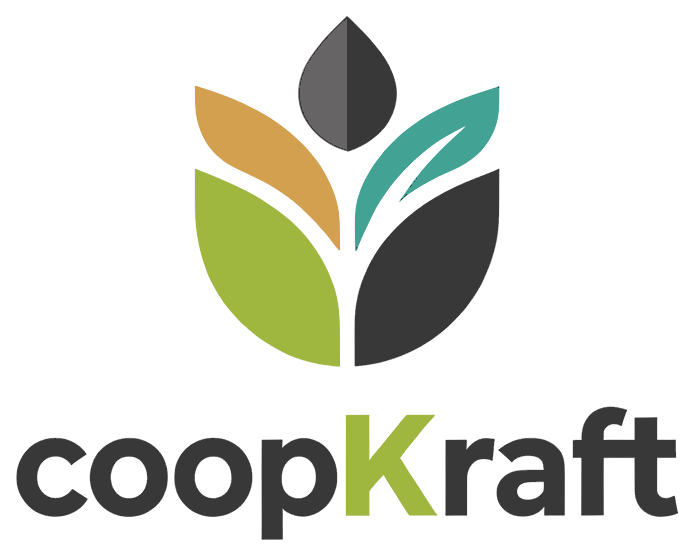
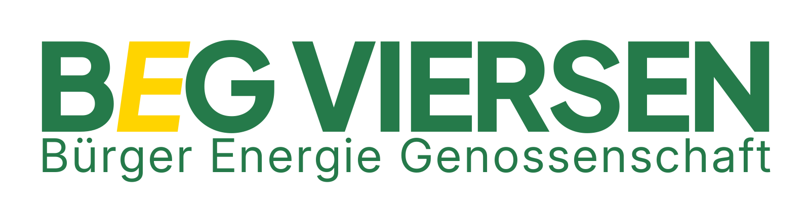

<h1>
  <picture>
    <source media="(prefers-color-scheme: dark)" srcset="docs/assets/coopkraft-logo-dark.png">
    
  </picture>
</h1>

> [!WARNING]
> **ALPHA:** CoopKraft is being tested internally and is not meant for production use yet. This repository is a preview: expect changes, and don't use it for real member data.

> Wie in professionellen Softwareprojekten üblich, ist diese Dokumentation auf Englisch. Warum wir CoopKraft bauen, steht in unserem [Manifest auf Deutsch](https://janhommes.github.io/coopkraft/manifest.html).

**[Try the demo](https://janhommes.github.io/coopkraft/demo/)**: it runs entirely in your browser with sample data. The [website](https://janhommes.github.io/coopkraft/) is built from `docs/*.html` and published together with the demo by `.github/workflows/pages.yml`.

Built by the [Bürger Energie Genossenschaft Viersen (BEG Viersen)](https://buergerenergie-viersen.de/) for our own members, and shared as open source so that every energy cooperative can use it for free.

CoopKraft is a platform designed for german based cooperatives and community-driven initiatives regarding the energy sector (Bürgerenergie). It aims to provide a cheap, efficient, and collaborative way for these organizations to manage the coop members, their shares, payments and other administrative tasks.


## The idea
When searching for a solution for our members we found out that software is expensive. A simple coop could use up to 500€ a month for basic management tools. We decided that this should not be the case by:
 - Open Sourcing: The platform is open source, allowing coops to use, modify, and contribute to the software without incurring high costs. 
 - Cost Efficiency: By providing a free and open-source solution, coops can significantly reduce their software expenses. In fact, we make it run on a minimal web-server basis (no hype-tech, only basic infrastructure PHP + MySQL) which costs coops less than 2€ a month.
 - Collaboration: The platform encourages community-driven development and sharing of best practices among coops.
 - Transparency: All changes and activities within the platform are visible to the community, ensuring accountability and trust among coop members.
 - Security: The platform is designed with security in mind. But also emphasizes simplicity and minimal attack surface by avoiding unnecessary complexity. E.g. the login and authentication process is externalized through SSO providers.

 # What we don't offer 
  - any other coop then energy cooperatives (Bürgerenergie).
  - services and maintenance other then best effort with the designed open source patterns.
  - mulilanguage or localization support (currently only German is supported).
  - advanced integrations with third-party services beyond the basic SSO setup.


 ## What you would need to get you started
  - A minimal web-server setup with PHP and MySQL.
  - Basic knowledge of PHP and MySQL for setup and maintenance (or an AI Agent of your choice)
  - A SSO provider for authentication (we as BEG Viersen are using nextcloud for this purpose)

  The full installation is described step by step in the [setup guide](docs/setup.md).


## Features

### Members
- **Member register**: search by name, email or member number, filter by status (pending, active, terminating, terminated, rejected). Member numbers are assigned automatically.
- **Member profile** with tabs for master data, shares, documents, approvals, termination, dividends and a per-member audit trail.
- **Master data**: private persons and companies, address (DE/AT/CH), bank details with IBAN validation, newsletter opt-in, and tax details (Freistellungsauftrag, church affiliation, federal state, tax ID).
- **Custom fields** (text, number, date, checkbox, select), optionally required and optionally shown on the signup form.
- **Self-service for members**: own dashboard and profile, edit own data, subscribe more shares, terminate or transfer shares, terminate the membership, and download documents shared with them.

### Roles and access
- Nine roles with separate permissions: Mitglied, Mitgliederverwalter, Vorstand, Aufsichtsrat, Mitgliedsbestätiger, Zahlungsprüfer, Kommunikation, Auszahler, Admin.
- **SSO group → role mapping** with a configurable group claim and a policy for unknown users. Members are recognized by their email. Stored per-user roles act only as overrides.
- **Login** via your SSO provider (OpenID Connect, e.g. Nextcloud). The demo version uses a user switcher in the header instead.

### Joining
- **Public signup form** at `/anmeldung`, as a multi-step wizard or a single page, with configurable title, intro text, statutes checkbox, newsletter opt-in and custom CSS.
- **Embeddable form** at `/embed/anmeldung`, with a copy-paste iframe snippet that adjusts its height automatically.
- **Approval workflow**: configurable number of approvals, optional supervisory-board approval, optional payment confirmation, and blocking of self-approval and double approval. A member becomes active automatically once all conditions are met.

### Shares
- Shares are tracked in lots (signing date, value per share, status: payment pending, active, terminating, transferred, repaid).
- Configurable share value and minimum/maximum shares per member.
- Payment confirmation per lot.
- **Transfers** between members, as a sale or a donation, with approval. Transferring part of a lot splits it.
- Overview of all lots across members.

### Termination
- Terminate the whole membership or individual shares (partial termination is possible).
- Configurable notice period, cut-off date (end of month, quarter, half-year or year, or a free date), minimum holding period, approver roles and number of approvals.
- The payout date is calculated: either immediately or after the annual accounts are adopted.
- A termination can be withdrawn until it takes effect. Due terminations and repayments are processed automatically on app start.

### Dividends and payouts
- **Dividend runs** per fiscal year and rate, calculated pro rata by days held for each lot.
- German withholding tax: Kapitalertragsteuer 25 %, Solidaritätszuschlag 5.5 %, Kirchensteuer 8 or 9 % depending on the federal state. Freistellungsaufträge are respected.
- **Tax certificate PDF** for each member, stored with the member's documents and visible to the member.
- Warnings before a run if the cooperative's master data or a member's tax details are missing.
- **SEPA bulk transfer** as XML (ISO 20022 `pain.001.001.09`), for a dividend run or for due share repayments.

### Communication
- Campaign editor with an HTML toolbar, branded header and footer, and live preview (desktop, mobile, source).
- Placeholders such as `{{vorname}}`, `{{nachname}}` and `{{mitgliedsnummer}}`, filled in per recipient.
- Recipients: newsletter opt-ins, all active members, or a hand-picked selection. Recipient lists export as CSV.
- Optional event with an `.ics` calendar file.
- Saved campaigns can be reopened in the editor and reused.

### Documents
- Cooperative documents (statutes, annual reports, minutes, other), visible to the public, to members only, or to administration only.
- Public documents get a shareable link at `/dokumente/<slug>`.
- Documents per member (application, ID copy, SEPA mandate, termination, tax certificate), optionally visible to the member.

### Dashboard
- **For members**: own shares, capital and dividends per year.
- **For board and staff**: key figures (active members, total capital, pending joins, terminations, open payments, own pending approvals, dividends paid), charts for member growth and capital, and a list of pending joins.

### Administration
- **Branding**: name, logo, and primary, accent, background and sidebar colors, applied across the app.
- **Newsletter branding**: header and footer HTML (can be generated from the branding) and email colors.
- Cooperative master data (address, tax number, VAT ID, register court and number) and bank account (IBAN, BIC, creditor ID).
- Workflow settings for joining, termination and transfers.
- **Database and backup**: record counts per table, backup download and restore as a JSON file, and reset to demo data.

### Data storage
- **Self-hosted**: a PHP API (`backend/`) with MySQL/MariaDB. Each data area is one table that stores the record as JSON, so the database and the backup file match 1:1 (`docs/schema.sql`). The server checks roles and permissions on every request.
- **Demo**: without a backend, all data stays in the browser (IndexedDB). This is also what the Lovable preview uses.
- All data access goes through `src/services/*`, so the UI works the same in both modes.

## Development

The UI is built with [Lovable](https://lovable.dev) (it syncs the `main` branch). The backend in `backend/` is built separately with Claude Code. `AGENTS.md` sets out which agent edits which files.

```
src/                 React app (TanStack Start), built in Lovable
src/services/        data access; db.ts switches between IndexedDB and the API
backend/             PHP 8.2+ API (Slim 4) – REST over docs/schema.sql, SSO login, permissions
docs/schema.sql      database schema (MySQL/MariaDB), applied automatically by the backend
scripts/             contract check frontend/backend, deploy bundle
```

- Demo mode: `bun install` and `npm run dev`
- With backend: `docker compose -f backend/docker-compose.yml up -d`, then `API_PROXY=http://localhost:8092 VITE_API_URL=/api npx vite dev --port 8080`. Log in with the simulated SSO form.
- Checks: `node scripts/check-contract.mjs`, `npx tsc --noEmit`, and the backend tests: `docker compose -f backend/docker-compose.yml exec api vendor/bin/phpunit`
- Releases: once CI passes on `main`, [semantic-release](https://semantic-release.gitbook.io/) creates them from the commit messages ([Conventional Commits](https://www.conventionalcommits.org/)): `fix:` → patch, `feat:` → minor, `feat!:` or a `BREAKING CHANGE:` footer → major. Lovable's commit messages don't follow this format, so they never trigger a release on their own and ship with the next one. Each release is deployed to production (if `DEPLOY_ENABLED` is set) and reaches the cooperatives' forks: patch and minor versions automatically, major versions as a pull request.

## Deployment

See the [setup guide](docs/setup.md): hosting requirements, SSO client, configuration, deploying with GitHub Actions or by hand, first login, role mapping and troubleshooting.

In short: `scripts/build-deploy.sh` builds `deploy/`, which contains the static app plus the PHP API in `deploy/api/`. Upload it by FTP to the root of a (sub)domain. The workflow `.github/workflows/deploy.yml` can do this automatically.

## Sponsor

<a href="https://buergerenergie-viersen.de/">
  <picture>
    <source media="(prefers-color-scheme: dark)" srcset="docs/assets/beg-viersen-logo-dark.png">
    
  </picture>
</a>

CoopKraft is sponsored by the [Bürger Energie Genossenschaft Viersen (BEG Viersen)](https://buergerenergie-viersen.de/).
